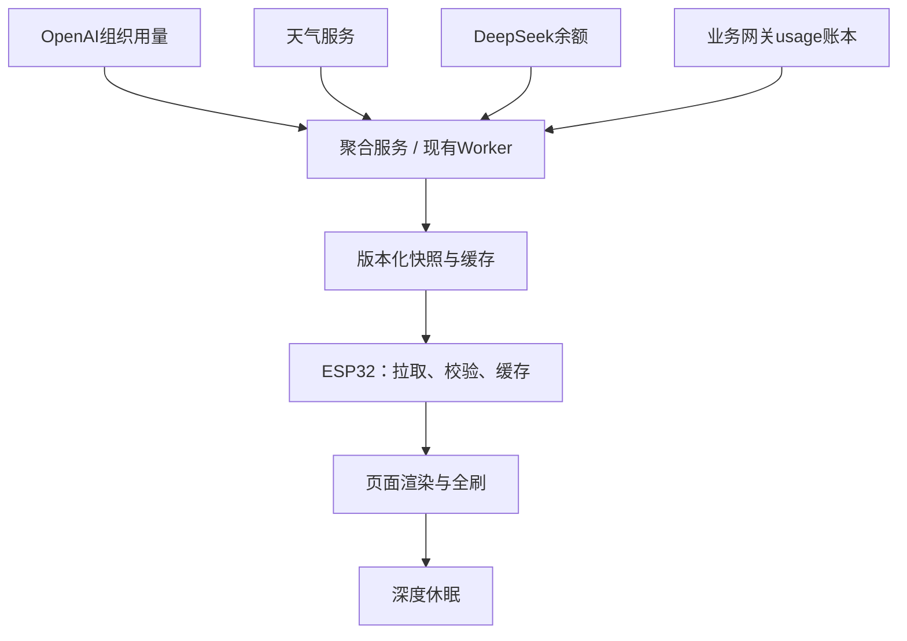

# J-Calendar 桌面信息屏：功能设计与 Agent 开发任务

设计日期：2026-10-18。目标分支：`feat/openai-usage-calendar-panel`。本次核对的分支最新提交：`27beb8766f787ce25cf38ac71120665c4e222dbb`。本文是开发规格，没有修改或测试固件。

## 1. 设计结论

把设备定义为“日常信息 + AI API 用量”的低功耗桌面信息屏。默认主页同时显示日期、天气、OpenAI、DeepSeek、一个今日重点和更新时间。完整月历、详细天气、7 日用量曲线放在可手动切换的第二页，不在主页塞入完整月历。

第一版按 API Token 用量设计。ChatGPT Plus/Pro、Codex 订阅额度与 OpenAI API 组织用量不是同一口径；如用户实际需要订阅剩余额度，需要另加数据源适配器，不能拿 API Token 冒充订阅剩余量。

## 2. 仓库核对结果

| 项目 | 已确认情况 | 对设计的影响 |
|---|---|---|
| 屏幕 | README：4.2 英寸、400×300、黑白红三色 | 以横向 400×300 设计；不使用灰阶 |
| 固件 | ESP32、Arduino、PlatformIO | 沿用现有工程，不重写硬件层 |
| 字体与驱动 | GxEPD2、U8g2；中文 12/16 字号字库 | 中文必须使用相应中文字库 |
| 构建目标 | 默认 z21；另有 1680/z98/z15/esp32c3 | 默认目标不等于实物型号，需要核对丝印 |
| 页面 | `screen_ink.cpp` 的当前有效路径只绘制 `draw_deepseek_token_panel()` | 名称与实际的天气/待办/DeepSeek主页不一致 |
| OpenAI | 有 `openai_usage.cpp` 和 Worker，当前 `main.cpp` 未调用 | 恢复接入，不从零实现 |
| DeepSeek | `deepseek.cpp` 调用模型生成寄语，累加本机请求的 usage 到 NVS | 该数字不是账户全局用量；不能继续这样标注 |
| 当前刷新 | 每小时唤醒，强制全刷；每次保留 Web 约 30 秒 | 属调试流程，需恢复产品级调度 |
| 局刷 | 存在局刷函数及模式变量，当前主流程强制全刷 | 有函数不代表实物支持，应以实测能力开关控制 |
| OpenAI代理 | Worker `/v1/usage/today`，UTC 当天，缓存 300 秒 | 需统一北京时间统计并处理跨日缓存 |
| 安全 | OpenAI用 CA；DeepSeek存在 `setInsecure()`，天气页面可写 key | 统一把供应商密钥放服务端，设备只持读取令牌 |

仓库 README 中的旧按键说明与当前有效代码有差异；实施以有效代码路径为准。本次已读取 README、platformio.ini、main.cpp、screen_ink.cpp、deepseek.cpp、openai_usage.cpp、proxy/openai_usage_proxy.js、proxy/README。附件照片未完成像素级核验，不能据此推断实际屏幕丝印、字体清晰度或局刷能力。

## 3. 主页像素布局

采用统一 8 px 外边距、8 px 间隔。以下矩形均为半开区间，`x+w<=400, y+h<=300`。

| 区块 | x/y/w/h | 内容与排版 |
|---|---|---|
| 日期栏 | 8 / 8 / 384 / 32 | 左：10月18日 周日；右：电池图标；日期约24px，星期16px |
| 天气区 | 8 / 48 / 384 / 70 | 城市、图标、当前温度；次行今日高低温与天气文字；有可靠数据才显示提醒 |
| OpenAI卡 | 8 / 126 / 188 / 100 | 标题16px；今日Token约24px；输入/输出12px；末行范围与状态 |
| DeepSeek卡 | 204 / 126 / 188 / 100 | 同等视觉权重；主值用量；次行余额；末行“网关统计”或“未接入” |
| 今日重点 | 8 / 234 / 384 / 36 | 单项待办/阅读计划/倒计日；16px，默认一行，长文本按像素宽截断 |
| 状态栏 | 8 / 278 / 384 / 14 | 显示“画面 09:00 · 数据有延迟”或“离线 · 保留08:00数据”；12px |

示例数据：日期10月18日周日；天气“北京 21°C 晴 / 今日14–23°C”；OpenAI“1.28M / 入1.02M 出260K / API项目·今日”；DeepSeek“642K / 余额 CNY 83.20 / 网关·今日”；今日重点“阅读20分钟”。所有示例均为虚构数据，不能当真实天气或账户用量。

视觉规则：白底、黑字；红色仅用于今天标记、重要待办、真实告警；不用大面积红底和装饰性进度条。无分母时不画“剩余百分比”。用户预算可以画预算进度，但必须标注“自设预算”，不是厂商硬限额。数字使用 K/M/B，单位按四舍五入处理进位；保留完整整数用于详情。中文12px仅用于辅助信息，常用正文16px；通过字体测量排版，不按字符串字节数裁剪。禁止用只有西文字形的 `6x10` 字体画中文。

### 其他页面

1. 月历页：复用原完整月历及农历、假日、倒计日；不给主页让出空间而压缩六行月历。
2. AI详情页（第二阶段）：OpenAI与DeepSeek切换查看输入/输出、模型分组、7日柱状图、统计范围、源更新时间。模型标签来自数据，不固定为Flash/Pro。
3. 天气详情页（第二阶段）：三天天气；有真实小时降水数据才提示“未来两小时降雨”，只有日预报时只写“今日有雨”。

按键：单击唤醒并切到下一启用页面；双击进入180秒配置窗口；长按3秒重新拉取；恢复出厂移到配置页并要求二次确认，避免原长按误清配置。OneButton先完成单/双/长按判定再执行；按键释放稳定后才启用低电平唤醒，避免按住不放循环重启。页面数量及最后页用NVS保存，但定时唤醒不应轮播页面。

## 4. 功能优先级

| 优先级 | 功能 | 说明 |
|---|---|---|
| P0 | 日期、天气、双供应商用量、余额、更新状态 | 第一阶段交付 |
| P0 | 缓存、离线显示、刷新计划、配置迁移 | 与页面同时交付，避免演示可用实物不可用 |
| P1 | 月历切换、待办、倒计日、低余额/预算提示 | 待办优先复用daily_brief；现有按日期轮换列表必须标“轮换提示”，不能冒充真实日程 |
| P1 | 通勤/跑步天气提示、阅读计划 | 基于天气规则和用户设置，不需每次调用LLM |
| P2 | 7日用量趋势、外部日程同步、一个科技标题 | 服务端提供真实数据；标题一行，正文在手机阅读 |

主页优先显示下一项重要事情，不同时叠加单词、寄语、多条新闻。第一版不开启定时模型生成。

## 5. 数据架构



沿用 Cloudflare Worker 做聚合层，不新增Python服务作为第一版前置条件。需要网关账本时可增加D1/现有数据库；设备保持小JSON协议与本地渲染，不转为云端图片渲染。新的 `/v1/dashboard` 与旧 `/v1/usage/today` 暂时并存，避免旧固件突然失效。

### OpenAI

读取官方组织用量接口，按配置的project/key筛选；所有分页与结果均需聚合。明确显示“组织”或“项目”范围，不能默认把整个组织当个人使用。输入+输出作为总Token；缓存输入通常是输入细分，不能再重复相加。金额需要时另读Costs，不能根据总Token直接乘统一单价；首版不承诺实时精确金额。API组织数据不包含ChatGPT订阅剩余额度。

### DeepSeek

官方 `/user/balance` 可读取余额；本次核对的公开文档没有确认可直接查询账户每日总Token的官方接口。实施前复核最新文档；未确认时不虚构usage endpoint、不抓登录Cookie。

采用三种显式状态：
- 只有余额：显示“Token未接入”，余额正常展示；Token字段为null，不为0。
- 接入既有业务网关：从真实模型响应usage建立账本，显示“网关统计”；只覆盖流经网关的请求。
- 若今后提供官方账户usage：新增provider_account适配器，才显示“账户统计”。

禁止为查询用量而调用模型。余额变化无法可靠换算Token，受充值、赠送、缓存、价格与其他请求影响。启用寄语必须是用户独立选择的功能，单独预算、单独频率、缓存结果。

网关记录字段：provider/request_id/attempt_id/model/UTC时间/input/output/cache细分/usage来源/完整性。请求ID去重只去重同一事件，真实重试attempt不能吞掉；流式收集终结usage，断流无usage标unknown，不归零；不记录prompt与回答正文。采用动态模型名、服务端64位整数。费用使用十进制定点数或Decimal；不同币种不直接相加。

### 日期和时效

默认时区Asia/Shanghai，可配置。今日采用本地00:00至当前时刻的半开区间，服务端计算UTC边界。例如2026-10-18北京时间00:00对应2026-10-17T16:00:00Z。官方bucket的跨界与分页必须按接口支持的粒度处理并测试，不能只换一个date标签。凌晨缓存key包含设备、范围、时区、本地日期，跨日到期，不把昨天显示为今天。

每个数据源独立区分observed_at（源时间）、fetched_at（拉取时间）、status、source、coverage。HTTP200不代表源数据新鲜。不能用渲染时间冒充统计更新时间。

## 6. 最小协议

`GET /v1/dashboard`；HTTPS；Authorization设备读取令牌；响应不含供应商key。位置及范围由设备ID映射服务端配置，首版不允许任意URL透传。

```json
{
  "schema_version": 1,
  "generated_at": "2026-10-18T01:00:00Z",
  "timezone": "Asia/Shanghai",
  "local_date": "2026-10-18",
  "weather": {
    "status": "ok", "source": "qweather",
    "observed_at": "2026-10-18T00:50:00Z",
    "fetched_at": "2026-10-18T01:00:00Z",
    "location_name": "北京", "temp_c": 21,
    "temp_min_c": 14, "temp_max_c": 23,
    "condition": "晴", "condition_code": "100"
  },
  "usage": [
    {
      "provider": "openai", "status": "ok",
      "source": "provider_api", "coverage": "project",
      "window_start": "2026-10-17T16:00:00Z",
      "window_end": "2026-10-18T01:00:00Z",
      "fetched_at": "2026-10-18T01:00:00Z",
      "observed_at": null,
      "input_tokens": 1020000, "output_tokens": 260000,
      "total_tokens": 1280000,
      "balance": null
    },
    {
      "provider": "deepseek", "status": "not_configured",
      "source": "gateway_ledger", "coverage": "gateway_only",
      "window_start": "2026-10-17T16:00:00Z",
      "window_end": "2026-10-18T01:00:00Z",
      "fetched_at": null, "observed_at": null,
      "input_tokens": null, "output_tokens": null,
      "total_tokens": null,
      "balance": {"status":"ok", "currency":"CNY", "amount":"83.20", "fetched_at":"2026-10-18T01:00:00Z"}
    }
  ],
  "focus": {"type":"manual", "text":"阅读20分钟"},
  "refresh_after_seconds": 7200
}
```

天气缺当前观测时temp_c可以为null，改显示今日高低温。status枚举至少包括ok/stale/not_configured/unsupported/error/unknown。余额独立状态，避免余额成功让Token失败变成成功。counts为非负64位整数，校验total=input+output；部分记录缺失则加partial完整性标识。首版响应上限8KiB，趋势和模型列表不进入主页响应；ESP端有界读取，拒绝超长文本/负数/溢出/未知主版本，忽略可兼容新增字段。

服务端内部缓存与客户端缓存分开：内部缓存可短TTL；客户端响应private/no-store，避免携带账户数据的响应被公共缓存。内部缓存key隔离设备与数据范围，校验鉴权后才读缓存；使用ETag时，数据版本与响应业务内容一致，generated_at只随新快照变化。鉴权失败401、限流429使用有限退避；源部分失败仍返回其他模块，失败模块保留最后有效快照。

## 7. 固件结构与边界

建议新增：
- `include/dashboard_model.h`：固定上限的数据结构、枚举、uint64_t。
- `src/dashboard_client.cpp`：TLS、HTTP、有界JSON解析、错误映射。
- `src/dashboard_cache.cpp`：版本化缓存、校验和、原子更新。
- `src/refresh_scheduler.cpp`：电源模式、时区、下一次唤醒。
- `src/dashboard_renderer.cpp`：只读快照、本地布局、截断和格式化。

复用：`battery.cpp`、`daily_brief.cpp`、月历/农历逻辑、GxEPD2底层；从`screen_ink.cpp`逐步迁出新主页，不做与功能无关的大重构。新增模块没有HTTP权限之外的硬件副作用；渲染不得请求网络、写NVS或生成模型内容。所有驱动访问只由一个屏幕任务拥有；绘制期间使用不可变快照，避免网络线程修改数据。

主循环：加载配置和缓存 → 判定唤醒原因 → 识别按键手势 → 限时连网/校时 → 拉取快照 → 校验并合并各模块 → 必要时全刷 → 关闭无线和屏幕 → 计算下一次唤醒 → 休眠。保留现有用户网络配置，增加配置版本迁移，不擦NVS；废弃旧DeepSeek自调用累计值，不迁移成账户总量。

屏幕状态hash仅包含真正影响显示的内容，排除毫秒时间；若页脚显示时间只在实际刷屏后更新。相同内容无需全刷；日期跨日、有效页面切换、告警改变可触发。新模型和新字段放服务端适配，设备不硬编码供应商价格。

## 8. 刷新、功耗与离线

| 模式 | 默认策略 | 说明 |
|---|---|---|
| 电池均衡（默认） | 07:00–23:00每2小时；00:05跨日更新 | 每日约10次；非危险提示不夜间频刷 |
| 节能 | 07:30、12:30、19:30和00:05 | 天气与用量是快照 |
| 外接电源 | 可配置30或60分钟 | 未有USB检测硬件前只能手动选择，不凭空自动检测 |
| 手动 | 长按拉取，有30秒冷却 | 最小刷屏间隔仍受面板实测约束 |

以上为产品初始建议，不是厂商允许刷新频率承诺。默认所有驱动仅全刷；只有确认面板控制器、驱动实现与实物长测后才开启局刷能力。红层变化走全刷，不对未知面板注入LUT。

定时唤醒不开放30秒Web窗口；配置模式才开放，180秒超时。WiFi约10秒、网络拉取约15秒、SNTP约5秒为初始预算；总在线工作预算应有限且不含屏幕最坏刷新时间，BUSY超时按实际面板刷新规格制定，不套统一15秒。任何失败都能进入休眠。NVS只在配置或重要缓存变化时写；RTC缓存仅在实际保留RTC内存的配置下使用。断电缓存建议文件系统双槽+版本/校验，并先核实分区余量；存储不够则采用两槽有界NVS快照，测写入频次。

天气默认超过2小时标stale、超过6小时不再作“当前天气”，保留最后观测时间；用量跨日不把旧数字归属新的一天，显示“昨日缓存/今日未知”。时间未同步但RTC可信可继续；完全未知则显示“时间待同步”，不显示1970或伪造当天。WiFi失败也能基于缓存绘制，不能像当前有效主流程一样直接跳过所有显示。低电量按实测电压和负载校准；未安装ADC分压时显示电量未知，不画空电池。设备睡眠期间无法实时触发余额告警，提示必须明确是最近快照。

README约1.6mAh/次只是项目作者旧场景估算：10次/日约16mAh，加静态和其他负载后900mAh电池理论不足56天；24次/日约38.4mAh，理论不足24天。不能承诺半年待机。实际需要测唤醒、WiFi、屏刷、休眠的电流积分，以及电池有效容量。

## 9. Agent任务拆解

每个任务独立提交；先接口/假数据，再真实数据，再硬件。以下文件名为建议，开发前先检查仓库AGENTS与现有头文件。

| ID | 工作与主要路径 | 依赖 | 验收 |
|---|---|---|---|
| T00 | 基线审计：platformio.ini、include/驱动选择、src/main.cpp；记录RAM/Flash/分区与屏幕型号 | 无 | 默认z21可构建；列出其他目标；保留编译日志；没有实物则明确待验 |
| T01 | 协议：dashboard_model.h、docs/dashboard-api.md、fixtures | T00 | 成功/部分失败/跨日/未配置/超大计数/长中文样例齐全 |
| T02 | 修正DeepSeek：禁用自动寄语；拆分usage与balance状态；弃用旧累计值 | T00 | 普通刷新零chat/completions；余额成功不冒充用量成功 |
| T03 | 聚合服务：proxy/新增dashboard模块，保留旧路由 | T01 | 鉴权、范围隔离、本地日窗口、分页、限流、跨日缓存、单源失败通过验证 |
| T04 | DeepSeek网关usage账本适配；优先接现有业务网关，不为屏幕强制迁移全部应用 | T01/T02 | 只有网关内数据；事件去重、真实重试、流式缺usage、动态模型名测试通过；未接入显示null |
| T05 | 固件client与cache：dashboard_client/cache | T01/T03 | TLS校验；大包截断拒绝；64位解析；缓存损坏回退；断网/断电恢复 |
| T06 | 主页与字体：dashboard_renderer、screen_ink.cpp | T01 | 400×300所有元素无越界；中文无缺字；0/未知/十亿计数/负温度/长城市名可读 |
| T07 | 调度和休眠：main.cpp、refresh_scheduler | T02/T05 | 定时不开放Web；所有异常有限退出；跨日正确；无无限等待；记录实际刷新次数 |
| T08 | 页面与按键/配置迁移：main.cpp、_preference头文件 | T06/T07 | 单双长按互斥；旧WiFi保留；180秒配置退出；按住唤醒不循环；恢复出厂有确认 |
| T09 | 联调与功耗验收：test/、docs/ | T03–T08 | 72小时实物运行；断网、低电、跨日、按键、BUSY异常；给出电流积分与续航范围 |
| T10 | 第二阶段：7日图表、天气详情、阅读/日程扩展 | T09 | 仅在P0稳定后实施；未知日期曲线不画成零 |

T04可以推迟；第一版允许DeepSeek只显示余额及“Token未接入”，其余功能完整工作。P0交付顺序：T00→T01→T02/T03→T05/T06→T07/T08→T09。此顺序是任务依赖，不要求多agent同时改文件。

### 交给开发Agent的总指令

> 在feat/openai-usage-calendar-panel分支基于本文实现400×300黑白红三色ESP32桌面信息屏。先阅读适用AGENTS和现有驱动头文件，完成T00记录，不改变针脚、分区或屏幕驱动。按T01协议先构造fixture和主页，再接/v1/dashboard。复用现有Worker、月历和字体；不重写项目。优先停用展示链路中的DeepSeek模型调用，禁止把本机寄语Token当账户用量。OpenAI按配置组织/项目统计，DeepSeek网关用量明确标注覆盖范围；未配置/未知不显示为0。所有供应商密钥置服务端，设备使用只读令牌与CA验证；日志不输出密钥。默认全刷，局刷必须实物确认。所有网络、校时、屏幕等待有截止时间，断网保留可识别时间的缓存并休眠。配置迁移保留WiFi。每个任务提交说明实现、验证、待硬件验证项；没有运行测试或实物验证不得声称通过。首版不实现自动新闻、订阅额度抓取和通用LLM网关。

## 10. 验证场景

- 07:59 UTC→08:00 UTC以及北京时间23:59→00:00：今日窗口、缓存隔离、源延迟提示。
- 多页/多项目OpenAI响应：聚合不漏页；缓存输入不重复累加；无权限不显示0。
- DeepSeek只有余额、只有账本、余额失败、流式缺usage：独立状态与unknown传播。
- 计数0、999999、4294967296、极大值；输入为负、JSON类型错、主版本未知：格式和拒绝策略。
- WiFi失败、TLS失败、HTTP429/500、响应超限、NVS损坏、断电重启、BUSY卡住：有限退出和有用的旧画面。
- 中英文混排、缺字、负温度、最长允许的城市/待办、预算超额：像素边界与真实屏可读性。
- z21以及仓库仍维护的其他目标编译；默认/无密钥均可构建。实物72小时不复位、不泄漏堆内存、没有意外模型请求。

## 11. 落地前需确认的事项

不阻塞默认设计：实物屏幕丝印/驱动究竟z21还是其他；电池还是USB为主、电池容量与ADC是否接线；期望API用量还是ChatGPT/Codex订阅额度；DeepSeek已有调用入口是否可提供usage账本；默认城市及统计范围。未确认时采用z21为工程默认但不冒充实物型号，电池均衡模式，API口径，DeepSeek仅余额。

## 12. 参考

- 仓库分支：https://github.com/Jackwin/jcalendar/tree/feat/openai-usage-calendar-panel
- 显示实现：https://github.com/Jackwin/jcalendar/blob/feat/openai-usage-calendar-panel/src/screen_ink.cpp
- 主流程：https://github.com/Jackwin/jcalendar/blob/feat/openai-usage-calendar-panel/src/main.cpp
- DeepSeek实现：https://github.com/Jackwin/jcalendar/blob/feat/openai-usage-calendar-panel/src/deepseek.cpp
- OpenAI代理：https://github.com/Jackwin/jcalendar/blob/feat/openai-usage-calendar-panel/proxy/openai_usage_proxy.js
- OpenAI用量：https://developers.openai.com/api/reference/resources/admin/subresources/organization/subresources/usage/methods/completions
- OpenAI金额：https://developers.openai.com/api/reference/resources/admin/subresources/organization/subresources/usage/methods/costs
- DeepSeek余额：https://api-docs.deepseek.com/api/get-user-balance/
- DeepSeek Token口径：https://api-docs.deepseek.com/quick_start/token_usage/
